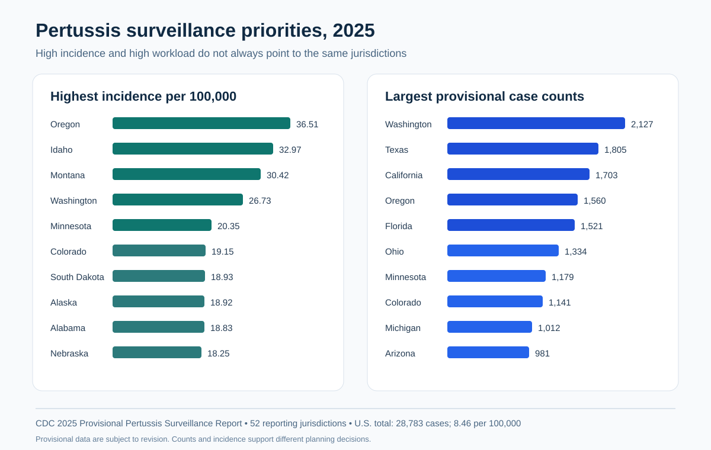

# Pertussis Surveillance Priorities: Rate, Burden, and Geography in 2025



## Executive summary

Where should public-health teams focus when **high incidence** and **high case volume** point to different places?

This project analyzes the CDC's 2025 provisional pertussis surveillance report across 52 reporting jurisdictions (50 states, the District of Columbia, and New York City). It uses reproducible DuckDB SQL and a QGIS-ready join table to separate population-adjusted intensity from operational case burden.

- CDC reported **28,783 provisional U.S. cases** and a national incidence of **8.46 per 100,000**.
- **Oregon** had the highest jurisdiction-level incidence at **36.51 per 100,000**.
- **Washington** had the largest case count (**2,127**) and the fourth-highest incidence (**26.73 per 100,000**).
- Five jurisdictions had incidence at or above 20 per 100,000: Oregon, Idaho, Montana, Washington, and Minnesota.
- Texas ranked second by case count (**1,805**) but its incidence (**5.77**) was below the national rate. This illustrates why rate and burden answer different planning questions.

These data are provisional and descriptive. They cannot establish individual risk, vaccine effectiveness, causes of geographic variation, or the current 2026 situation.

## Decision question

How can surveillance programs distinguish jurisdictions with unusually high pertussis incidence from jurisdictions carrying the greatest absolute case-management burden?

## Audience and use case

The analysis is designed for epidemiologists, surveillance analysts, immunization programs, healthcare data analysts, and public-health leaders allocating investigation, laboratory, communication, and prevention resources.

## Tools and skills demonstrated

- **SQL / DuckDB:** typed ingestion, validation, ranking, case-share calculations, threshold flags, and exportable views
- **QGIS:** state-name join table, explicit handling of the separately reported New York City jurisdiction, and reproducible choropleth instructions
- **Epidemiology:** incidence versus count interpretation, provisional surveillance caveats, denominator awareness, and noncausal communication
- **QA/QC:** row-count, duplicate, range, missingness, and national-total reconciliation checks

## Data source

The source is the CDC **2025 Provisional Pertussis Surveillance Report**. The jurisdiction rows reconcile exactly to the reported national total of 28,783 cases.

- [CDC Pertussis Surveillance and Trends](https://www.cdc.gov/pertussis/outbreaks/)
- [2025 Provisional Pertussis Surveillance Report (PDF)](https://www.cdc.gov/pertussis/media/pdfs/2026/02/363295-A_FS_PertussisSurveillanceReport_011626_508pass.pdf)
- [NNDSS provisional-data interpretation guidance](https://www.cdc.gov/nndss/infectious-disease/)
- [NNDSS weekly data catalog](https://data.cdc.gov/NNDSS/NNDSS-Weekly-Data/x9gk-5huc/about_data)

The project intentionally preserves New York State and New York City as separate reporting jurisdictions in the analytic table. The QGIS state join excludes New York City and labels New York State coverage explicitly rather than silently combining non-equivalent rates.

## Repository structure

```text
data/raw/                       source-transcribed CDC jurisdiction table
docs/                           data dictionary and portfolio case study
outputs/figures/                recruiter-ready SVG dashboard
outputs/tables/                 ranked results and QA checks
qgis/                           state join table and mapping workflow
sql/                            executable DuckDB analysis
```

## Reproduce with DuckDB

Install the free [DuckDB CLI](https://duckdb.org/docs/installation/) and run from the repository root:

```bash
duckdb pertussis.duckdb < sql/analysis.sql
```

The script imports the raw CSV, enforces types, runs QA assertions, creates analytic views, and exports the ranked output tables.

## Build the QGIS map

Follow [qgis/README.md](qgis/README.md). The workflow uses free QGIS and Census cartographic boundaries. Join on state name, map `incidence_per_100k`, and retain the New York coverage annotation in the layout.

## Interpretation

Incidence identifies unusually intense reported disease occurrence relative to population size. Counts describe workload and the number of reported events. Washington appears near the top by both measures. Texas and California have large counts but lower rates, while Idaho and Montana have high rates with smaller counts. A practical response dashboard should show both.

## Limitations and ethics

- The 2025 figures are provisional, subject to revision, and affected by reporting delays.
- Reporting practices, case ascertainment, healthcare access, testing, and jurisdiction-specific requirements may differ.
- Ecological comparisons do not describe individual risk or explain why a jurisdiction's rate is high.
- The data cannot be used to estimate vaccine effectiveness because they lack an appropriate comparison group and individual-level vaccination denominators.
- New York State and New York City are separate NNDSS reporting jurisdictions.
- No PHI, confidential data, or Texas DSHS information is used.

## Author

**Kira Gor, BDS, MPH**  
Epidemiology and healthcare data analytics  
[Portfolio](https://gorkira28.github.io/) · [LinkedIn](https://www.linkedin.com/in/dr-kira-gor/) · [GitHub](https://github.com/gorkira28)

## License

Code and documentation are released under the [MIT License](LICENSE). CDC source data remain governed by their original terms and documentation.

